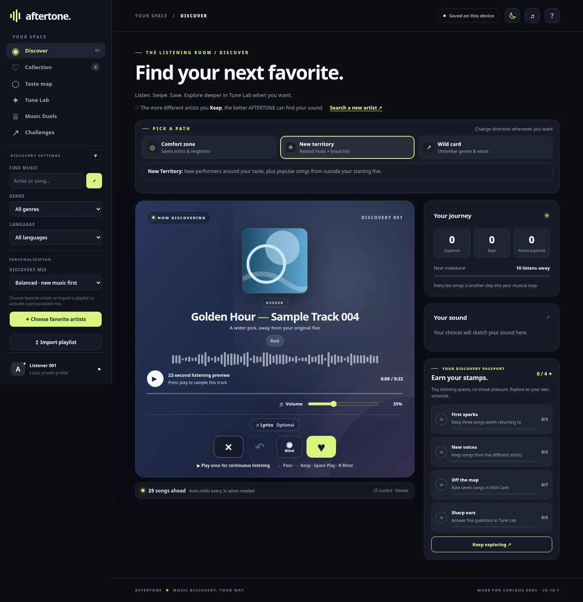
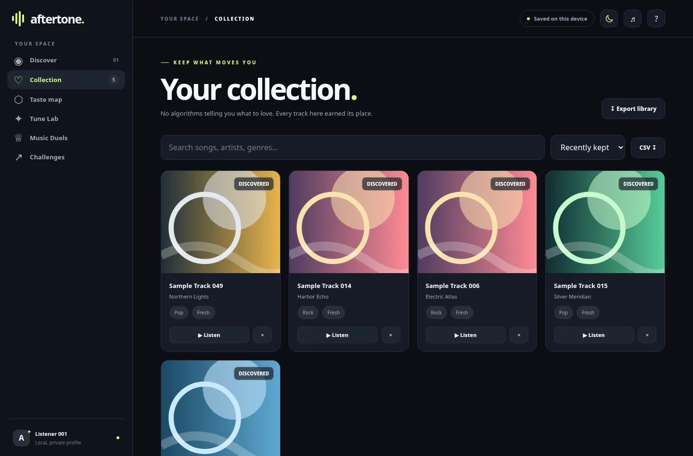
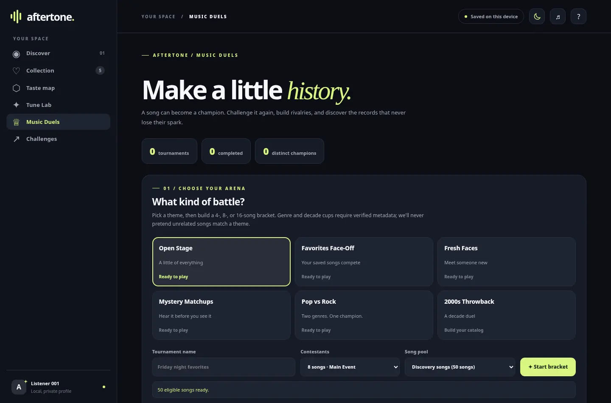
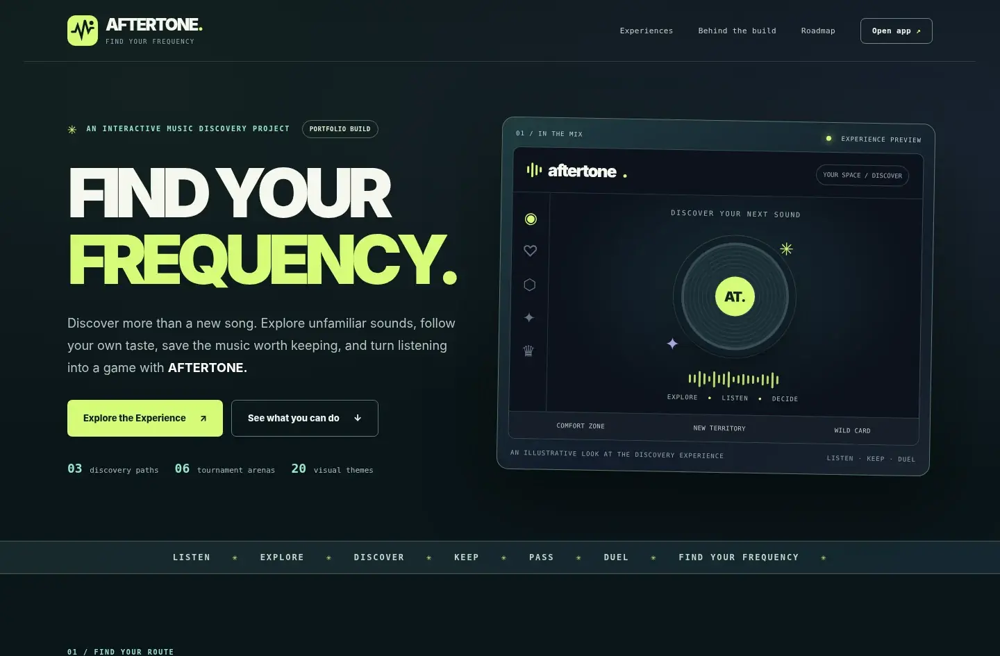

<div align="center">

<a href="https://aftertone.masynnay.com/"></a>

# AFTERTONE

**Find your next favorite song.**

A music discovery experience built around listening, exploring, and discovering what you love.

**Real music discovery · Personalized paths · Music Duels · 20 themes**

[Live portfolio](https://aftertone.masynnay.com/) · [Open the app](https://aftertone.masynnay.com/demo/) · [Screenshots](#screenshots) · [Features](#features) · [Get started](#get-started) · [Roadmap](docs/ROADMAP.md) · [Open issues](https://github.com/MasynNay/aftertone/issues) · [Latest release](https://github.com/MasynNay/aftertone/releases/tag/v0.11.0) · [Changelog](docs/CHANGELOG.md)

</div>

---

## Discover Music Your Own Way

AFTERTONE turns music discovery into something you can interact with. Listen to a short preview, choose **Keep** or **Pass**, and let your choices guide what you hear next. Search for artists, explore unfamiliar genres, save favorites, and challenge your music knowledge in tournament-style **Music Duels**.

This is a portfolio project built around a real music discovery application—not a static mockup or a fictional 12-song demo. The [portfolio homepage](https://aftertone.masynnay.com/) presents the project and its engineering. Select **Explore the Experience** to launch the [original browser app](https://aftertone.masynnay.com/demo/) directly. There is no popup or embedded mockup.

> **Portfolio and third-party media notice:** The public demo requests third-party catalog information and short audio previews where available. Music-provider availability, browser restrictions, and licensing can affect playback. The project does not host or redistribute commercial recordings, and a working preview is not guaranteed in every region or browser.

## Roadmap and Active Development

AFTERTONE is being improved in small, testable releases. The immediate priority is making the published experience more reliable, especially browser loading, Deezer fallback behavior, and responsible third-party media use.

**[View the development roadmap](docs/ROADMAP.md)** · **[Browse the open GitHub issues](https://github.com/MasynNay/aftertone/issues)**

**Current release: [v0.11.0](https://github.com/MasynNay/aftertone/releases/tag/v0.11.0)** — verified portfolio preview featuring recoverable discovery, versioned progress backups, and resumable Music Duels. Next: **v0.12** accessibility and mobile refinements. Outstanding Deezer playback/permissions checks remain documented in the [roadmap](docs/ROADMAP.md). [Backup and Restore guide](docs/BACKUP_RESTORE.md).

## Screenshots

### Inside AFTERTONE

These are browser captures of the **real AFTERTONE interface**—not redesigned mockups. To create consistent, rights-safe screenshots, the application was rendered with representative **sample tracks and original placeholder artwork**, rather than live Deezer catalog results. They demonstrate the UI and user flows, **not verified provider playback**.

**Discover** — choose a listening path, see artwork and track details, adjust volume, and keep or pass a discovery.

[](docs/screenshots/app-discover.webp)

**Collection** — locally saved favorites, searchable track cards, and export controls.

[](docs/screenshots/app-collection.webp)

**Music Duels** — six tournament arenas and a customizable competition setup.

[](docs/screenshots/app-music-duels.webp)

### Portfolio Website

**Desktop homepage** — the Keystoria-inspired portfolio introduction and direct **Explore the Experience** launch.

[](docs/screenshots/portfolio-landing.webp)

[View the responsive mobile homepage](docs/screenshots/portfolio-mobile.webp) · [Launch the actual application](https://aftertone.masynnay.com/demo/)

## Features

- **Real music discovery.** Explore Deezer catalog metadata, artist information, album artwork, related artists, and short preview audio when the provider makes it accessible.
- **Three discovery paths.** **Comfort Zone** builds on artists and songs you already enjoy. **New Territory** explores less-familiar artists. **Wild Card** takes you toward unexpected genres and sounds.
- **Keep or Pass.** Quickly react to a track, undo a choice, and build a collection based on your listening preferences.
- **Search and explore.** Look up artists and songs, browse by genre, era, or language, and optionally import public Deezer playlists.
- **Music Duels.** Compete across six tournament arenas with accurate eligibility counts, resume unfinished brackets after refreshing, and see champions recognized in the **Hall of Fame**.
- **Taste map and Tune Lab.** Explore your listening preferences and experiment with your music collection.
- **Challenges and progress.** Track personal discoveries, completed activities, tournament results, and related history in the browser.
- **Player controls.** Autoplay after the user starts playback, volume adjustment, mute, skip, and responsive listening controls.
- **20 visual themes.** Personalize the experience with different looks and layouts.
- **Local persistence and exports.** Favorites, preferences, and tournament history remain in browser storage, with CSV exports for supported data.

## Try AFTERTONE

| Experience | What you'll find |
| :-- | :-- |
| [Portfolio homepage](https://aftertone.masynnay.com/) | Product showcase, feature cards, engineering notes and inline portfolio notice; **Explore the Experience** opens the app |
| [Full-screen application](https://aftertone.masynnay.com/demo/) | The complete browser interface, without the surrounding portfolio page |
| **Local Node application** | Original Node backend with direct provider requests and optional locally configured services |

The public site uses a browser-side Deezer adapter rather than a Node server. Playback and catalog requests depend on the third-party service remaining accessible. The local application is the primary maintained backend implementation.

## Get Started

### Run Locally

You'll need **Node.js 20 or newer**. Clone or download the repository, then run:

```bash
npm start
```

Open **http://127.0.0.1:4173** in your browser.

For a convenient launcher, use `scripts/launch/START_MAC.command` on macOS or `scripts/launch/START_WINDOWS.bat` on Windows.

### Build the Portfolio

```bash
npm run build
```

This generates the static GitHub Pages site in `dist/`. The generated folder is not the source of truth: edit `site/`, `app/public/`, and the relevant browser-safe modules instead.

## How It Works

```text
                       AFTERTONE
                           |
                +----------+----------+
                |                     |
        GitHub Pages site       Local Node app
           (site/)              (app/server.mjs)
                |                     |
        Browser-safe adapter    Provider requests
                |                     |
                +----------+----------+
                           |
                 Music discovery UI
                  (app/public/)
                           |
            +--------------+--------------+
            |              |              |
        Keep / Pass   Music Duels    Taste & Collection
            |              |              |
            +--------------+--------------+
                           |
                 Browser local storage
```

The interface uses HTML, CSS, and JavaScript modules. The local backend runs on Node.js, while the public GitHub Pages version uses a browser adapter to request Deezer catalog data and supported short previews.

The game and discovery history are stored locally in the browser, not in a hosted AFTERTONE account. The launched browser application preserves its original saved-data keys; the portfolio homepage does not access or modify that storage.

For implementation details, see the [architecture guide](docs/ARCHITECTURE.md).

## Repository Structure

```text
aftertone/
├── .github/workflows/    Automated checks and GitHub Pages deployment
├── app/                  Original music discovery application
│   ├── public/           User interface, styles, and browser adapter
│   ├── src/              Discovery, playlists, taste, and tournament logic
│   └── server.mjs        Local Node server
├── site/                 Standalone portfolio homepage (no popup or iframe)
├── scripts/              Build, validation, and launch tools
│   └── launch/           macOS and Windows launchers
├── test/                 Automated tests and browser adapter checks
├── docs/                 Screenshots, architecture, and project history
├── package.json          Development and build commands
├── LICENSE               MIT license for the project software
└── README.md             Project overview
```

Application code stays under `app/`, the portfolio under `site/`, and documentation under `docs/`. The GitHub Actions workflow publishes only the generated `dist/` output—not private settings, local media, or server-only source files.

## Development and Testing

```bash
npm test         # Automated tests
npm run check    # Syntax checks, tests, static build, and site validation
npm run build    # Generate the static portfolio and browser app
npm run dev      # Run the local Node server with watch mode
```

Automated checks cover application logic and the browser adapter. They cannot guarantee that Deezer or another external provider will serve music in a particular environment; live playback should be tested separately.

## Technology

- **Frontend:** HTML, CSS, JavaScript (ES modules)
- **Local backend:** Node.js 20+
- **Music discovery:** Deezer catalog metadata and short previews, subject to provider access
- **Saved progress:** Browser local storage
- **Static hosting:** GitHub Pages with GitHub Actions
- **Architecture:** Browser-compatible music discovery modules plus a local server implementation

## Project Resources

- [Architecture and technical notes](docs/ARCHITECTURE.md)
- [Real-browser deployment checks](docs/BROWSER_TESTING.md)
- [First-listen and empty-search guide](docs/FIRST_LISTEN.md)
- [Backup and restore user progress](docs/BACKUP_RESTORE.md)
- [Current product roadmap](docs/ROADMAP.md)
- [Open GitHub development issues](https://github.com/MasynNay/aftertone/issues)
- [Release history](docs/CHANGELOG.md)
- [Music Duels documentation](docs/MUSIC_DUELS.md)
- [Portfolio overview](docs/PORTFOLIO.md)
- [Credits and licensing considerations](docs/CREDITS_AND_LICENSING.md)
- [Development checkpoint](docs/development/CONTINUE_HERE.md)

## Third-Party Content and Limitations

AFTERTONE is an independent software portfolio project, not an official Deezer product.

The public version uses Deezer's browser-accessible catalog interface and links to short preview audio where available. **API access and preview URLs are not a license to use recorded music in a public game.** Appropriate permission from rights holders or providers may be needed for broader distribution or commercial use.

GitHub Pages cannot host the local Node server. Browser-based provider access can change without notice; optional synced lyrics depend on LRCLIB access and content rights. Locally configured services such as a private Jellyfin library are not available through the public site.

The repository does not include or rehost copyrighted recordings, and no private service credentials are published.

## License

The original AFTERTONE source code is available under the [MIT License](LICENSE). That license applies to the project software, **not** third-party music, recordings, artwork, or provider services.
